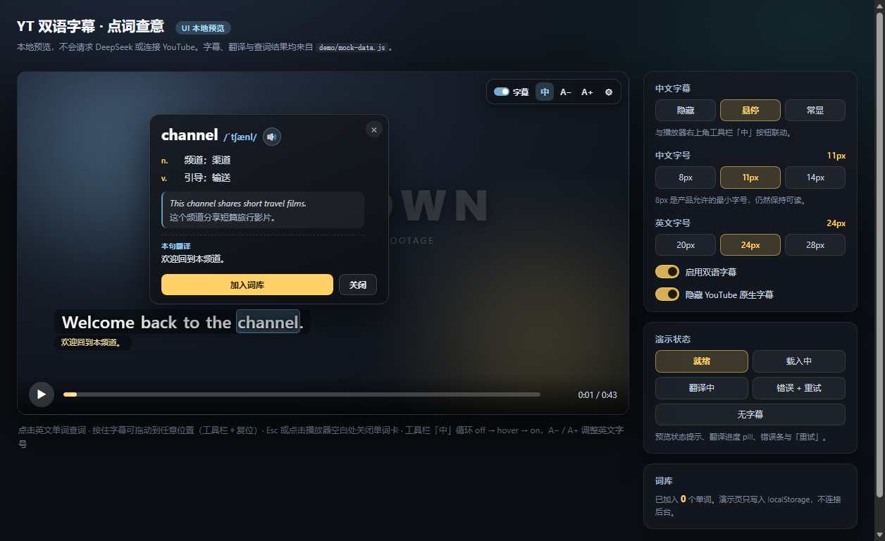
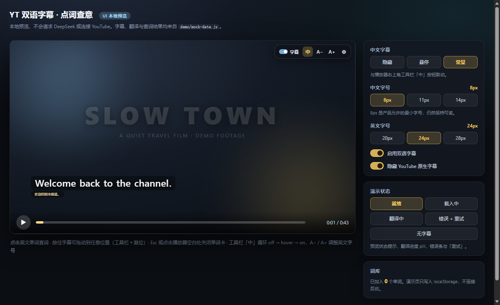
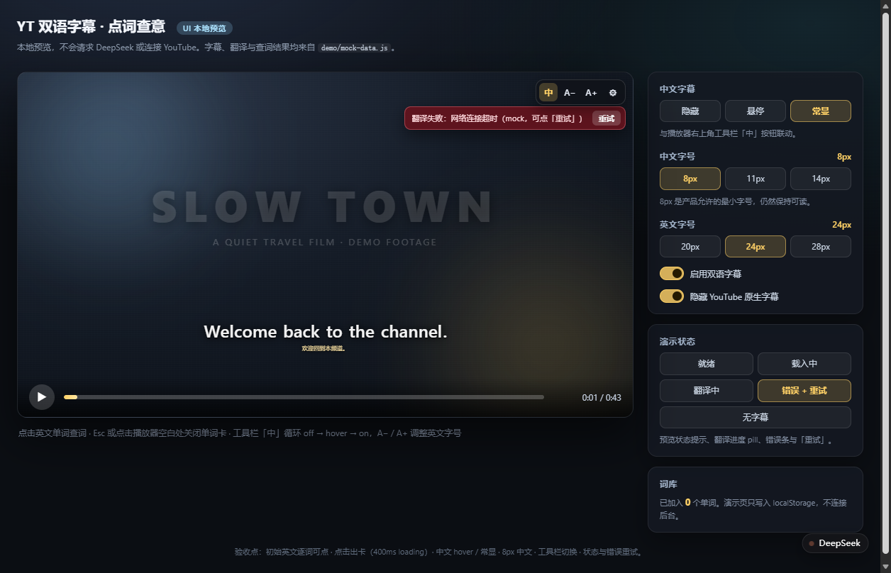
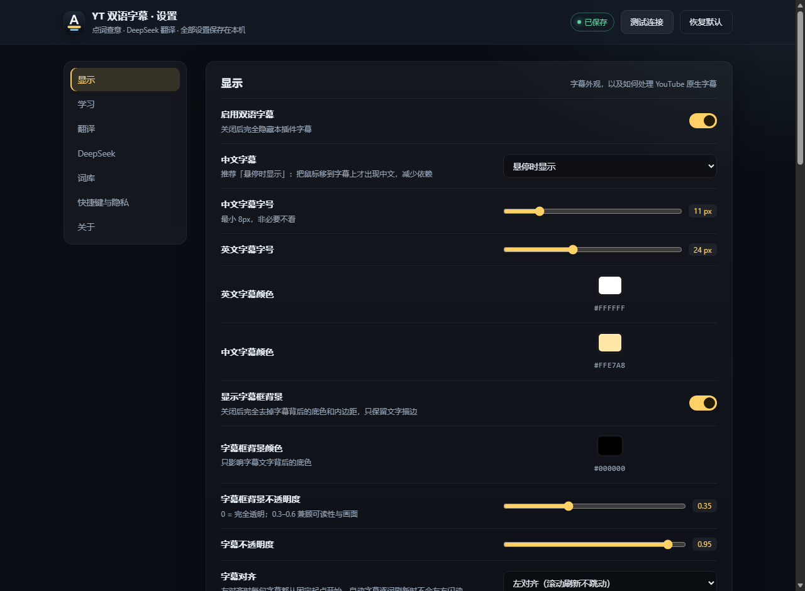
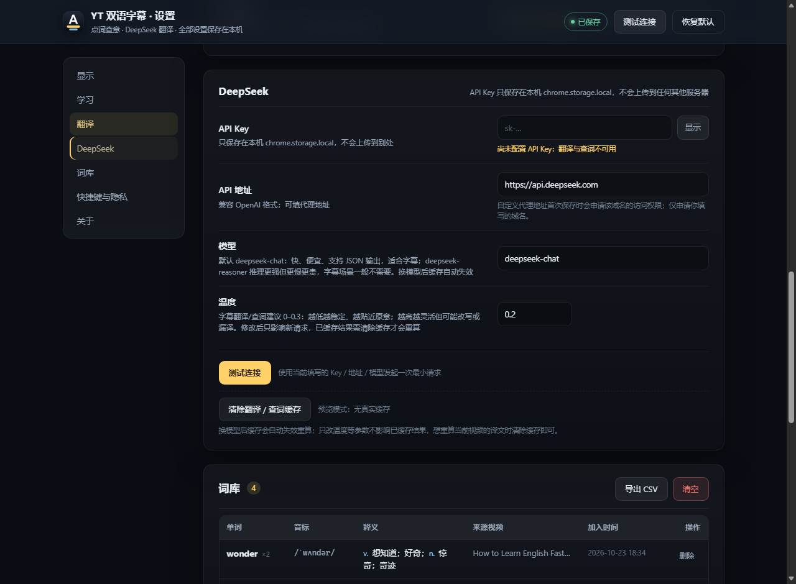
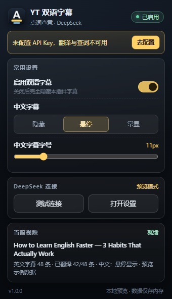
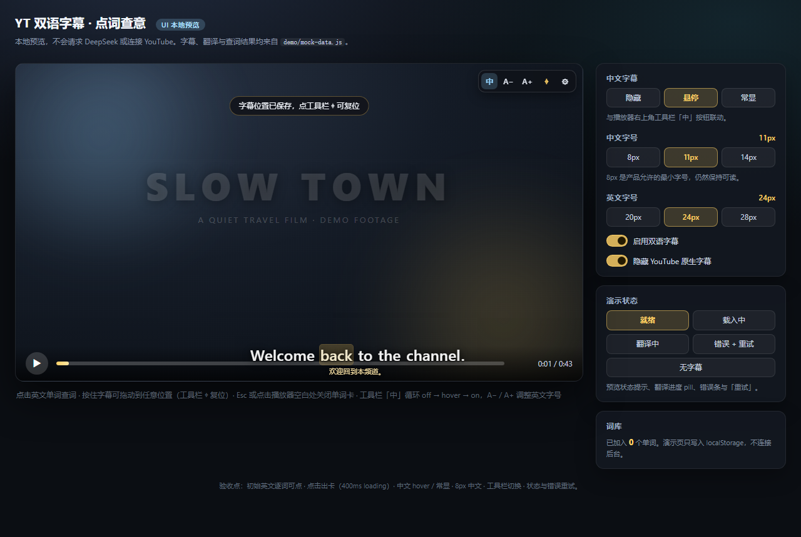

# YT 双语字幕 · 点词查意

**把 YouTube 变成可点词的英语精读工具。**

一个为「用 YouTube 学英语」设计的 Chrome / Edge 扩展（Manifest V3）：**英文字幕逐词可点**，点一下就用 DeepSeek 查词；**中文字幕默认不打扰**，悬停才出现，也可以缩到 8px 或彻底隐藏。翻译和查词结果缓存在本地，同一句 / 同一个词只花一次钱。

> A Chrome/Edge extension that turns YouTube into an interactive English reader: click any English word for a DeepSeek-powered dictionary card, while Chinese subtitles stay out of the way (hover, 8px, or hidden).

[](https://developer.chrome.com/docs/extensions/develop/migrate)
[](https://www.google.com/chrome/)
[](https://www.microsoft.com/edge)
[](https://platform.deepseek.com/)
[](NOTICE.md)
[](LICENSE)

> **AI 生成内容声明**：本项目代码、文档、示例数据、界面文案和截图说明均由 AI 生成或 AI 辅助生成，并经人工整理与测试。AI 生成内容可能有误，仅供学习参考。开源协议为 **MIT License**，详见 [NOTICE.md](NOTICE.md) 与 [LICENSE](LICENSE)。



## 项目介绍

看视频学英语时，最破坏沉浸感的两件事是「查词要切窗口」和「中文字幕一眼看完就不听英语了」。这个扩展把这两件事都收进播放器：

- **点词即查**：英文字幕里的每个单词都是按钮，点击后暂停并弹出单词卡——音标、英英释义（在中文释义上方）、中文释义、例句、常见派生词、常见短语、本句英英改写 + 中文翻译、朗读、加入词库；
- **中文不抢戏**：默认悬停才显示，也可以缩到 8px 或隐藏，字幕还能调颜色、背景、位置并自由拖动；
- **本地优先**：DeepSeek API Key 只存在浏览器本地，翻译与查词结果缓存复用，不收集观看记录。

适合想用真实语料练听力、精读和积累词汇的英语学习者。当前版本 **v1.0.0**，支持桌面 Chrome 111+ / Edge（Chromium），无需构建、直接加载源码即可使用。

> 状态说明：核心的「覆盖模式」稳定可用；「原生英文 + 中文」实验模式（依赖 YouTube 原生字幕层）**暂时关闭**，相关代码保留在仓库中。

## 截图

| 逐词字幕 + 单词卡 | 中文常显（8px） | 错误与重试 |
| --- | --- | --- |
|  |  |  |

| 设置页（显示） | 设置页（DeepSeek） | 工具栏弹窗 |
| --- | --- | --- |
|  |  |  |



> 拖动后位置自动保存，工具栏出现金色 `⌖` 可一键复位；全屏/剧场模式下按比例跟随。

> 截图来自本地 demo 与 file:// 预览（浏览器插件浮标、「预览示例数据」字样属于预览环境）。

---

## 为什么是这两个设计

看视频学英语时，最破坏沉浸感的两件事是「查词要切窗口」和「中文字幕一眼看完就不听英语了」。这个扩展的做法是：

- 英文单词本身就是按钮：点任意单词 → 视频暂停 → 单词卡（音标、词性释义、例句、本句翻译、常见派生词/短语、朗读、加入词库），继续播放即回到语境。本句翻译可在设置 →「学习」里关闭。
- 中文字幕默认 **hover 才显示**，还可以调成 8px 的「几乎看不见」或完全隐藏；翻译仍会自动准备好，需要时立刻出现。
- 翻译和查词都走 **DeepSeek API**，结果缓存在本地，同一句/同一个词只花一次钱。

## 功能

| 功能 | 说明 |
| --- | --- |
| 英文字幕逐词点击 | 自动读取视频英文轨（含自动生成字幕），每个单词可点，hover 高亮 |
| DeepSeek 查词卡 | 音标、**英英释义（显示在中文释义上方）**、中文释义、例句、常见派生词、常见短语、本句英英改写 + 中文翻译、用法提示；🔊 系统 TTS，无可用语音时回退有道在线发音 |
| 单词卡中文开关 | 设置 →「显示」→「单词卡显示中文释义」：隐藏点词卡片里的中文释义/例句翻译/派生词短语中文（不影响视频字幕）；字幕中文仍用工具栏「中」按钮切换 |
| 中文字幕三态 | `隐藏` / `悬停显示`（默认）/ `常显`，一键切换 |
| 中文字幕字号 | 8–24px 无级调节，8px 仍保持可读，默认 11px |
| 字幕排版 | 英文字号、整体不透明度、距底部高度均可调；字幕可**左对齐（默认，自动字幕刷新不左右跳动）**或居中；自动隐藏 YouTube 原生字幕避免重复 |
| 字幕模式 | 目前固定使用**覆盖模式**（插件渲染英文+中文，英文可点词）；「原生英文 + 中文」实验模式暂时关闭，代码保留 |
| 字幕总开关 | 播放器工具栏最左侧「◉ 字幕」开关：关闭插件字幕，默认退回 YouTube 原生字幕；打开「关闭字幕后也隐藏原生字幕」后则整块字幕都不显示 |
| 字幕颜色 / 背景 | 英文、中文字幕颜色分别可调；字幕框背景颜色 + 不透明度可调，也可以**整个关闭字幕框背景**（只留文字描边） |
| 字幕自由拖动 | **按住字幕块即可拖到播放器任意位置**，位置自动记忆、全屏/剧场模式按比例跟随；工具栏 `⌖` 或设置页「复位字幕位置」一键回到底部居中 |
| 自动翻译 | 按当前播放位置预翻译后续句子，批量请求 + 本地缓存 + 失败重试 |
| 词库 | 一键收藏单词，设置页查看 / 删除 / 导出 CSV（可导入 Anki、Excel） |
| 快捷键 | `Alt+Z` 切中文模式、`Alt+[` / `Alt+]` 调中文字号、`Alt+E` 开关字幕 |
| 隐私 | API Key 只存在本机 `chrome.storage.local`，只请求你配置的 DeepSeek 地址；点击朗读且系统无可用语音时，会请求 `dict.youdao.com` 的发音音频 |

## 快速开始

### 1. 准备 DeepSeek API Key

到 [platform.deepseek.com](https://platform.deepseek.com/api_keys) 创建 API Key（`sk-` 开头），账户里需要有少量余额。翻译几个视频的成本通常不到一分钱（见下方「费用」）。

### 2. 安装扩展

1. 打开 `chrome://extensions/`（Edge 为 `edge://extensions/`）；
2. 右上角打开「开发者模式」；
3. 点「加载已解压的扩展程序」，选择本项目根目录（含 `manifest.json` 的那一层，即 `yt-bilingual-subs/`）。注意：请选择**解压后的文件夹**，不要直接选择 zip 文件；
4. 安装后会自动打开设置页；也可以在扩展图标右键 →「选项」。

> 不想用源码：到 [Releases](https://github.com/yangyuanxi44/yt-bilingual-subs/releases/latest) 下载 `yt-bilingual-subs.zip`，用系统解压后按上面第 3–4 步加载解压目录。

### 3. 配置

在设置页 →「DeepSeek」：

- 填入 API Key；
- 模型默认 `deepseek-chat`；
- 点「测试连接」确认可用（会显示延迟）；
- 默认 API 地址 `https://api.deepseek.com`，一般不需要改。若使用中转/代理，填写完整地址后保存时会请求该域名的访问权限。

### 4. 使用

打开任意带英文字幕的 YouTube 视频（`/watch` 或 `/live`）：

1. 插件右上角出现字幕工具栏（`◉字幕` / `中` / `A−` / `A+` / `⌖` / `⚙`）；
2. 英文字幕自动出现，中文按当前模式显示或悬停显示；点最左侧「◉ 字幕」开关可关闭插件字幕（默认恢复 YouTube 原生字幕），再点恢复；
3. **按住英文字幕（或中文字幕）拖到播放器任意位置**；松手即保存，全屏/剧场模式按比例跟随。点工具栏 `⌖` 或设置页「复位字幕位置」回到底部居中；
4. **点击任意英文单词** → 视频暂停并弹出单词卡；
5. 点「加入词库」收藏，关闭卡片继续播放；
6. 设置页「词库」可批量导出 CSV。

> 第一次进入某个视频时中文会逐句翻译，先显示英文，译文就绪后补上；之后再看同一视频直接走缓存。

## 字幕模式

> ⚠️ 「原生英文 + 中文」实验模式**暂时关闭**（代码保留，后续排查 YouTube 原生字幕渲染问题后再开放）。当前固定使用覆盖模式：插件渲染英文 + 中文，英文可点词。

~~在 设置 →「显示」→「字幕模式」切换，或直接点工具栏上的 `覆盖` / `原生` 按钮一键切换：~~

- **覆盖模式（默认，当前唯一启用）**：插件自己渲染英文和中文，保留逐词点击查词；自动字幕视频中文会滞后约 1–2 秒。
- ~~**原生英文 + 中文**：保留 YouTube 自己的英文字幕渲染，插件在原生字幕下方叠加一行中文……~~（暂时关闭）

> 原生模式需要 YouTube 播放器的 **CC 处于开启状态**：切换时会尝试自动打开 CC；如果原生字幕仍不可见，会暂时回退显示插件英文并提示。中文位置会根据原生字幕的实际位置动态定位，必要时把原生字幕上移给中文留空间；**原生模式下中文行也可以直接拖动**，工具栏 `⌖` 复位，全屏/剧场模式同样跟随。

## 中文翻译速度

- **有正常字幕轨的视频**（手动字幕/可获取的自动字幕）：插件会按「预翻译前瞻」提前翻译后面的句子，正常播放时中文通常是提前准备好的。想让缓冲更大，可在设置 →「翻译」把「预翻译前瞻」调到 60–80，把「每批句数」保持在 8–12。
- **YouTube 限制 timedtext 的自动字幕视频**：工具栏会出现 `DOM` 徽标，插件只能从播放器原生字幕 DOM 读取当前句。这种模式没有未来时间轴，只能「边说边翻」：新版会每约 1.4 秒补一次实时翻译，中文通常滞后 **半句到 1–2 秒**，并用最近一次译文兜底，不再长时间空白。这是该模式的物理上限；要彻底消除延迟需要拿到完整转写时间轴（见「已知限制」）。
- 中文一直不出来时，先看设置页「测试连接」的延迟；若延迟 > 3 秒，多半是网络/代理/模型问题，而不是扩展。换回 `deepseek-chat`、直连 `https://api.deepseek.com`、温度 0–0.3 即可。
- 换模型会让翻译缓存自动失效；只改温度/提示词不会，需要重算时点「清除翻译 / 查词缓存」。

## 快捷键

| 快捷键 | 作用 |
| --- | --- |
| `Alt+Z` | 中文字幕：隐藏 → 悬停 → 常显 循环 |
| `Alt+[` / `Alt+]` | 中文字幕字号 −1 / +1（8–24px） |
| `Alt+E` | 关闭 / 显示插件字幕（关闭后默认恢复原生字幕） |
| `Esc` | 关闭单词卡 |

## 实现原理

```
YouTube watch 页
├─ bridge.js（MAIN world，document_start）
│    └─ #movie_player.getPlayerResponse() → captionTracks（英文轨 baseUrl）
│       └─ 页面内 fetch(baseUrl + &fmt=json3) → timedtext JSON
├─ main.js（content script，隔离世界）
│    ├─ core.parseJson3：JSON3 → 按句切分、对齐时间轴
│    ├─ requestAnimationFrame + findCueIndex：与 video.currentTime 同步
│    ├─ 翻译队列：当前句 + 预翻译窗口，按 batchSize 分批 → background
│    └─ 点击单词 → background 查词 → ui 单词卡
├─ ui.js（Shadow DOM 挂载于 #movie_player 内）
│    ├─ 英文字幕逐词 span、中文行（off/hover/on）
│    ├─ 工具栏 / 单词卡 / 状态提示
│    └─ 全屏、剧场模式自适应（跟随 player 容器）
├─ background.js（MV3 service worker）
│    ├─ DeepSeek 调用（绕过页面 CORS，持有 API Key）
│    ├─ 翻译缓存 tc:* / 查词缓存 wc:*（chrome.storage.local）
│    └─ 词库 wordbook、测试连接、清缓存
└─ core.js：纯函数库（解析、分词、Prompt、响应校验），node 可直接单测
```

关键取舍：

- **字幕从 timedtext 拿全量**而不是监听 DOM：可以预翻译、按句对齐，点击单词时能拿到整句上下文；DOM 监听只作为没有 `getPlayerResponse` 时的降级方案。
- **翻译在 service worker 发请求**：页面内直接 `fetch` DeepSeek 会受 CORS 限制，MV3 的 background 有 host 权限，能稳定跨域。
- **模型输出强制 JSON**：`response_format: json_object` + 本地 `extractJson` 容错（围栏、前后废话、索引错位），解析失败自动修复重试一次。
- **缓存按文本哈希**：`cacheKey(text, model)` 与视频无关，同一句在多处出现只翻译一次；设置页可一键清空。
- **Shadow DOM + pointer-events 精细控制**：不污染 YouTube 样式，也不挡住播放器控件。

## 目录结构

```
yt-bilingual-subs/
├── manifest.json            # MV3 清单
├── src/
│   ├── lib/core.js          # 纯函数核心（解析/分词/prompt/响应校验）
│   ├── lib/translate.js     # DeepSeek 客户端（重试、JSON 修复、错误码）
│   ├── background.js        # service worker：缓存、词库、API 代理
│   ├── content/bridge.js    # MAIN world：读取 captionTracks + timedtext
│   ├── content/main.js      # 编排：同步、翻译队列、交互
│   ├── content/ui.js        # Shadow DOM UI：字幕、工具栏、单词卡
│   ├── content/styles.css   # 字幕 UI 样式
│   ├── content/page.css     # 页面级样式（隐藏原生字幕）
│   ├── popup/               # 工具栏弹窗
│   ├── options/             # 完整设置 + 词库
│   └── assets/icons/        # 扩展图标
├── demo/                    # 本地预览页（file:// 可直接打开，不连 YouTube/API）
├── test/                    # node 测试（core / translate / background 集成）
├── scripts/                 # 静态检查、真实浏览器冒烟、图标生成、打包
└── docs/CONTRACT.md         # 模块接口契约（开发用）
```

## 本地预览（不装扩展也能看 UI）

直接用浏览器打开 `demo/index.html`：内含假播放器、示例字幕、mock 翻译与查词，可体验点词卡片、中文 hover/8px、工具栏和设置联动。

## 开发与测试

```powershell
# 用本仓库自带的 node（或任意 Node 20+）
$node = "C:\Users\33488\.dsh\dsh-runtimes\dsh-primary-runtime\dependencies\node\bin\node.exe"

& $node --test                # 单元 + background 集成测试（node --test 自动发现 test/*.test.js）
& $node scripts/check.mjs     # 语法 / manifest 引用 / 架构红线检查
& $node --check src/content/main.js

# 真实浏览器冒烟（headless 加载扩展，检查 manifest / service worker / options / popup 与 background 消息路由）
& $node scripts/smoke-extension.mjs
# 端到端联动（假 YouTube 页面 + mock DeepSeek：bridge→字幕轨→双语渲染→点词卡片→缓存）
& $node scripts/e2e-youtube-mock.mjs
# 没有 Edge/Chrome 自动路径时：$env:BROWSER="C:\...\msedge.exe"; & $node scripts/smoke-extension.mjs
```

打包发布：

```powershell
powershell -ExecutionPolicy Bypass -File scripts/pack.ps1
# 生成 dist/yt-bilingual-subs.zip
```

## 费用

翻译缓存按句命中，查词缓存按「单词 + 上下文句」命中。以 `deepseek-chat` 为例，一个 10 分钟、约 150 句的视频，首次完整翻译大约消耗几千 token（远低于 ¥0.01 量级）；重复观看、拖动进度条都不会重复计费。可在设置里把「预翻译前瞻」调小以进一步节省。

## 常见问题

**Q: 安装时报「无法从以下源加载扩展 / 无法为脚本加载 JavaScript 'src/content/bridge.js'」？**
A: 这是旧版 zip 的路径分隔符不规范导致的：某些解压/安装工具会把 `src\content\bridge.js` 当成**一个文件名**（而不是 `src/content/` 下的文件），扩展就找不到脚本了。已修复打包脚本，请：
1. 在 `edge://extensions` / `chrome://extensions` 里删除加载失败的条目；
2. 使用**最新的** [Release zip](https://github.com/yangyuanxi44/yt-bilingual-subs/releases/latest)（或本仓库 `dist/` 下打包的 zip），用系统解压（右键 →「全部解压缩」）解到**新目录**；
3. 确认该目录里 `manifest.json` 和 `src\content\bridge.js` 是正常的文件夹结构（不是带 `\` 的怪文件名）；
4. 「加载已解压的扩展程序」时选择**解压后的文件夹**，不要直接选 zip 文件。
   也可以跳过解压，直接选择项目根目录 `yt-bilingual-subs`（含 `manifest.json` 的那一层）。

**Q: 模型和温度怎么调？**
A: 在设置页「DeepSeek」里直接改，300ms 自动保存，后台会立即用新值重建客户端，不用重启浏览器。
- 模型默认 `deepseek-chat`（快、便宜、支持 JSON 输出，适合字幕批量翻译）；`deepseek-reasoner` 推理更强但更慢、更贵，字幕场景一般不需要。也可以填任意兼容 OpenAI `chat/completions` 的模型名。
- 温度建议 **0–0.3**（默认 0.2）：越低越稳定、越贴近原意；越高越灵活，但可能改写或漏译。代码里限制在 0–1.5。
- 翻译和查词共用同一个模型和温度；翻译缓存的 key 包含模型名，**换模型会自动重新翻译**；只改温度不会让已有缓存失效，想重算当前视频的译文，点 DeepSeek 区的「清除翻译 / 查词缓存」。

**Q: 自动生成字幕的视频，字幕会显示一大段 / 一直不消失？**
A: 自动字幕（ASR）的 timedtext 接口现在常被 YouTube 限制（返回空），扩展会降级为读取页面原生 CC，此时工具栏会出现 `DOM` 徽标。旧版用 `display:none` 隐藏原生字幕，导致 YouTube 的滚动字幕失去布局、文本不断累积，于是屏幕上堆出一大段且不消失。新版已修复：
- 原生字幕改用 `opacity:0` 隐藏，保留原生滚动逻辑；
- DOM 兜底只显示最新一句 / 最多 16 个词，不再累积整段台词；
- 字幕停止 4.2 秒后自动清除；关闭 CC 时立即清空；
- 中文用最近一次译文兜底，可能比英文略滞后半句（自动字幕没有逐词时间轴）。

请重新加载扩展并**刷新 YouTube 页面**（F5）；如果仍看到旧的大段字幕，说明页面还在用旧的 content script。

**Q: 自动字幕刷新时字幕左右跳 / 一直闪？**
A: 自动字幕（ASR）只能逐词刷新，居中对齐时句子长度变化会让文字左右移动。新版默认改为**左对齐**：每句从固定左端开始，刷新时不会左右跳；同时更新字幕时会保留当前行再替换，减少闪白。如果想恢复居中：设置 →「显示」→「字幕对齐」选「居中」。

**Q: 字幕不出现 / 提示没有英文字幕？**
A: 该视频可能没有英文轨。请在 YouTube 播放器里打开 CC，确认有 English（自动生成也算）；插件会走 DOM 捕获降级。纯音乐、Shorts、直播无字幕时不可用。

**Q: 中文一直显示「译…」？**
A: 检查设置页「测试连接」；常见原因是 Key 无效、余额不足或网络不通。工具栏会出现错误提示，修好后点「重试」。

**Q: 为什么隐藏了 YouTube 原生字幕？**
A: 避免和插件字幕重复。可以在设置 →「隐藏 YouTube 原生字幕」关掉；或者点播放器工具栏的「◉ 字幕」开关关闭插件字幕——默认会恢复 YouTube 原生字幕（前提是播放器 CC 已开启）。如果关闭后仍没有原生字幕，检查设置 →「关闭字幕后也隐藏原生字幕」是否被打开，以及 YouTube 的 CC 按钮状态。

**Q: 能像 YouTube 原生字幕一样流畅吗？**
A: 原生字幕由 YouTube 播放器按精确时间轴直接渲染，没有「取字幕 → 调翻译」的往返；插件必须自己解析字幕并请求 DeepSeek。手动字幕视频可以靠预翻译做到接近原生；自动字幕视频（工具栏有 `DOM` 徽标）受 YouTube 接口限制只能边说边翻，英文逐词更新也会比原生更“跳”。想要完全原生流畅度时，点「◉ 字幕」关掉插件字幕、直接看 YouTube 原生字幕即可。（「原生英文 + 中文」实验模式暂时关闭，代码保留。）

**Q: 会把我看的视频/API Key 上传吗？**
A: 不会。字幕文本只发送给你配置的 DeepSeek API 用于翻译/查词；Key 只存在浏览器本地，不会写入页面 DOM 或远端。

**Q: 能用别的模型/中转吗？**
A: 可以，只要兼容 OpenAI `chat/completions` 且支持 JSON 输出。在设置里改「API 地址」和「模型」，保存时按提示授权该域名。

**Q: 支持手机 / Firefox / Safari 吗？**
A: 当前只支持桌面 Chrome / Edge（MV3，`world: "MAIN"` 需要 Chrome 111+）。

## 已知限制

- 仅处理 `/watch`、`/live` 页面；不支持 Shorts 与移动端。
- 只对英文轨做双语；非英语视频暂不支持。
- 依赖 YouTube 未公开接口 `getPlayerResponse()` / timedtext，若 YouTube 调整接口，降级方案是读取原生 CC 的 DOM 字幕（需开启 CC）。
- 单词卡按「单词 + 当前句」查询，同一单词在不同语境下会各缓存一次。

## AI 生成内容与开源协议

- **AI 生成内容**：本项目的源代码、文档、示例数据、界面文案、截图说明和发布文案均由 AI 生成或 AI 辅助生成，并经人工整理、调试与测试。AI 内容可能存在错误或遗漏，仅供学习参考，不构成任何专业建议或保证。
- **开源协议**：本项目采用 **MIT License**，可自由使用、修改和分发，但需保留版权与许可声明。
- **第三方说明**：本项目与 YouTube、Google、Microsoft、DeepSeek 均无官方关联；使用时请遵守相应服务条款与当地法律法规。

完整声明见 [NOTICE.md](NOTICE.md)，许可条款见 [LICENSE](LICENSE)。

## License

MIT，见 [LICENSE](LICENSE)。仅供个人学习使用。请遵守 YouTube 服务条款与 DeepSeek 使用条款；本项目与 YouTube、DeepSeek 官方无关。
